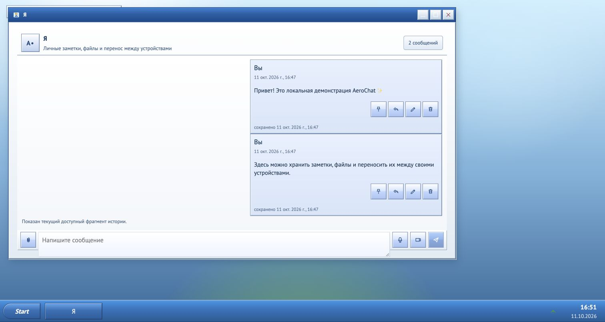
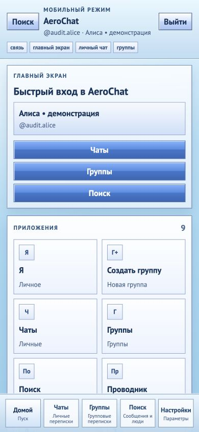

<a id="readme-top"></a>

<div align="center">
  
  <h1>AeroChat</h1>
  <p>Self-hosted веб-чат с рабочим столом в эстетике Windows XP / Frutiger Aero.</p>
  <p>Go · React · PostgreSQL · ConnectRPC · Monorepo</p>
</div>

AeroChat объединяет личные переписки, группы, файлы и аудиозвонки с оконным интерфейсом на ПК и полноэкранными страницами на телефоне. Проект развивается как alpha: реализованные возможности и результаты конкретных проверок описаны отдельно от продуктовых целей.

[Документация](docs/README.md) · [Разработка](docs/development.md) · [Возможности и ограничения](docs/product/capabilities.md) · [Состояние проекта](docs/project-status.md)

## Интерфейс

Рабочий стол с окнами переписок:



Мобильный интерфейс:



Снимки показывают локальный стенд из аудита 11 октября 2026. Они иллюстрируют интерфейс; границы проверки каждого сценария указаны в отчёте.

## Что реализовано

- Регистрация, сессии и устройства, профиль и privacy settings.
- Друзья по точному неизменяемому login, заявки и block policy без публичного каталога пользователей.
- Личные чаты, группы и роли, приглашения, realtime, typing/presence, read/unread, replies, edit, tombstone и pin.
- Encrypted direct-message v2 и отдельная encrypted group lane с локальной расшифровкой и поиском; encrypted media relay для вложений, voice/video notes и preview.
- Рабочий стол с несколькими окнами, Start, Explorer и локальными папками; launcher и route-backed страницы на узком экране.
- Канонический чат `Я` с backend self-direct thread и доставкой на активные устройства пользователя.
- Web Push для новых unread conversations и заявок в друзья; manifest и установка web-приложения.
- Signaling/control-plane, аудиозвонок 1:1 и group-call lobby; server compose включает TURN runtime.

Подробная карта возможностей — в [capabilities](docs/product/capabilities.md), результаты проверок и оставшаяся ручная приёмка — в [состоянии проекта](docs/project-status.md).

## Ограничения alpha

- Полная E2EE parity, полноценный MLS client, key backup/recovery и backfill старой encrypted history на новое устройство не завершены. В репозитории сохраняются legacy plaintext storage/model и ограниченные compatibility reads; общий claim «весь контент недоступен серверу» делать нельзя.
- Encrypted search ищет только по локально загруженному и расшифрованному окну сообщений; индекс ограничен текущей сессией браузера.
- Group calls дают control-plane/lobby без multiparty media transport. Для 1:1 нужны корректные ICE/TURN, доступ к микрофону и проверка реальной сетевой связности; наличие TURN в compose само по себе не доказывает надёжный звонок.
- Install и push существуют, но offline model, background sync и повседневная mobile/PWA готовность не завершены.
- Папки и расположение окон сохраняются локально в браузере; `aero-jobs` пока является runtime scaffold.

Продуктовая спецификация shell: [Web Shell XP](docs/product/web-shell-xp.md). Очередь развития: [roadmap](docs/roadmap.md).

## Локальный запуск

Требования: Git, Docker / Docker Compose. Для разработки из исходников также нужны Go **1.27.2**, Node.js **22**, pnpm **10.19.0** и инструменты из [development guide](docs/development.md). Go checks используют `GOTOOLCHAIN=go1.27.2`; security/toolchain policy и triage — в [Go lifecycle](docs/security/go-vulnerability-lifecycle.md).

> MinIO и bootstrap client собираются из закреплённых исходников с maintained dependencies по [ADR-087](docs/adr/087-pinned-storage-source-build-lifecycle.md); первый запуск требует Docker Hub, GitHub codeload и Go modules. Presign region fix уже включён; storage principal должен иметь `s3:GetBucketLocation` (см. [разработку](docs/development.md)).

```bash
git clone https://github.com/MattoYuzuru/AeroChat.git
cd AeroChat
cp .env.example .env
docker compose -f infra/compose/docker-compose.yml up --build -d
```

Открыть `http://127.0.0.1:${NGINX_PORT}` с портом из `.env`. При первом запуске `aero-identity` и `aero-chat` автоматически bootstrap'ят PostgreSQL-схему. Перед использованием проверить состояние контейнеров и gateway health/readiness.

```bash
docker compose -f infra/compose/docker-compose.yml ps
docker compose -f infra/compose/docker-compose.yml logs --tail=100 aero-gateway aero-identity aero-chat
```

Для browser uploads важен browser-visible `MEDIA_S3_PUBLIC_ENDPOINT`; для background push нужен полный VAPID-блок и secure context. Настройки media/quota/push, source-mode и последовательность lint/test/build описаны в [разработке](docs/development.md).

## Self-host

Server topology использует image-based Docker Compose и общий `k3s + Traefik` edge с TLS через `cert-manager`. Media публикуется на отдельном browser-visible origin. Repo-managed `coturn` работает как прямой host UDP/TCP service по [ADR-085](docs/adr/085-server-turn-runtime-and-public-relay-ip-contract.md).

Для подготовки сервера читать [single-server bootstrap](docs/deploy/single-server-bootstrap.md); production rollout, health gates и rollback описаны в [runbook](docs/deploy/production-rollout.md). Application images проходят gates точного SHA и выбираются по [immutable release manifest](docs/deploy/verified-release.md) с пятью image digests.

## Архитектура и код

| Путь | Ответственность |
| --- | --- |
| `apps/web` | React/TypeScript/Vite, shell, product pages, локальный crypto runtime |
| `services/aero-gateway` | Единый browser-facing ConnectRPC/realtime edge |
| `services/aero-identity` | Accounts, auth, social graph, crypto-device trust |
| `services/aero-chat` | Direct/group messages, encrypted lanes, attachments и lifecycle |
| `services/aero-rtc-control` | Call lifecycle, signaling и ICE credentials |
| `services/aero-jobs` | Scaffold будущей job-оркестрации |
| `libs/go` | Общие библиотеки runtime/auth/observability/testkit |
| `proto`, `gen/go` | Proto-first контракты и generated Go/Connect code |
| `infra`, `.github/workflows` | Local/server runtime, image delivery и CI |

Архитектурные инварианты: monorepo, Go-first backend, proto-first контракты, явные границы доменов и отдельные ADR для изменения auth/crypto/storage/transport/deployment. Криптографический протокол не импровизируется. [Навигатор](docs/README.md) связывает решения с реализацией и историческими аудитами.

## Вклад в проект

Каждая задача выполняется в отдельной ветке и узком PR. Поведение сопровождается тестами, документация обновляется вместе с кодом, коммиты следуют Conventional Commits. Обязательные правила — [AGENTS.md](AGENTS.md); команды и координация агентов — [development](docs/development.md).

Документация и полезные комментарии пишутся на русском языке. Реализованные возможности, открытые направления и исторические аудиты связаны через навигатор документации.

## Автор и лицензия

Автор: [MattoYuzuru](https://github.com/MattoYuzuru). [Репозиторий AeroChat](https://github.com/MattoYuzuru/AeroChat).

Лицензия пока не определена.
