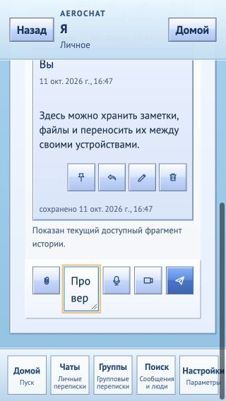
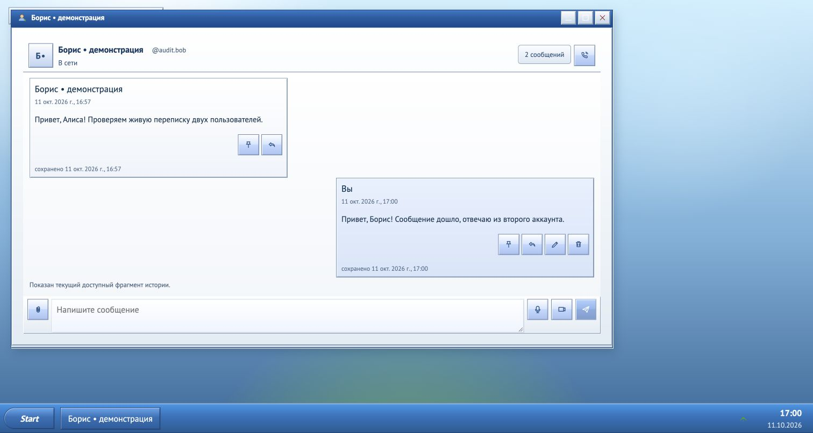
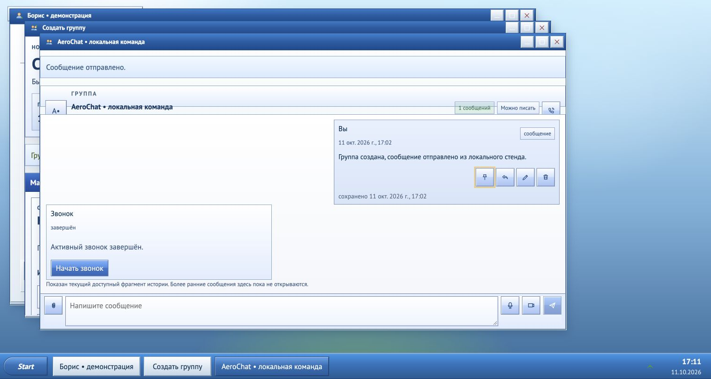

# Аудит готовности AeroChat — 11 октября 2026

> Исторический аудит ревизии `eab87dd`. Текущие возможности и ограничения — в [состоянии проекта](../project-status.md); исправления — в [сводке](2026-10-11-remediation.md).

Исходная ревизия: `eab87dd548ceddbf99570fb275eec39979f576e1`; ветка изменений: `codex/audit-portfolio-readiness`. Проверены локальный checkout, отдельный compose project `aerochat-audit`, браузерные test users и bounded fixtures. Production, SSH и другие проекты не входили в scope.

**Итог:** рабочие базовые сценарии общения и shell подтверждены локально; готовность надёжного повседневного мессенджера со всеми заявленными звонками не подтверждена. Найдены дефекты realtime/session, RTC playback/lifecycle/recovery, media/self-host, сообщений и mobile layout. Всего создано **30 подробных issues** и [общий tracker](https://github.com/MattoYuzuru/AeroChat/issues/178); отсутствие всех багов этот аудит не доказывает.

Общий tracker: [#178](https://github.com/MattoYuzuru/AeroChat/issues/178).

Этот отчёт сохраняет исходный audit evidence. Последующие отдельные draft fixes и границы их проверки перечислены в [remediation report](2026-10-11-remediation.md); результаты новых веток не переписывают исторические наблюдения ниже.

## Главные выводы

- RTC remote audio effect повторяет play/pause после render; bounded React fixture дал 4 play / 3 pause без пользовательских действий ([#157](https://github.com/MattoYuzuru/AeroChat/issues/157)). Это сильный кандидат на причину посредственного звука, акустический эффект не измерен.
- Capture, разрешённый после закрытия окна, создаёт peer и StartCall без последующего cleanup ([#158](https://github.com/MattoYuzuru/AeroChat/issues/158)); поздний ICE способен отменить recovery failed peer ([#159](https://github.com/MattoYuzuru/AeroChat/issues/159)). Прогон использовал реальный hook и fake media/PC/RPC; реальная сеть этим не проверена.
- Открытый websocket не перепроверяет отозванную session ([#149](https://github.com/MattoYuzuru/AeroChat/issues/149)); push endpoint не имеет guarded egress policy ([#150](https://github.com/MattoYuzuru/AeroChat/issues/150)); первый crypto-device bootstrap и RTC Join/End имеют transaction gaps ([#151](https://github.com/MattoYuzuru/AeroChat/issues/151), [#153](https://github.com/MattoYuzuru/AeroChat/issues/153)). Подтверждено trace исходников/SQL; специальные security reproductions не завершены.
- Обычный небольшого файла upload возвращает500: presign client ищет bucket region через browser-visible loopback из контейнера ([#165](https://github.com/MattoYuzuru/AeroChat/issues/165)). MinIO при этом доступен через internal endpoint. Помимо этого PUT/final attachment contract остаётся mutable/unbounded ([#152](https://github.com/MattoYuzuru/AeroChat/issues/152), static contract evidence).
- Cold-cache старт блокируется недоступными MinIO images ([#163](https://github.com/MattoYuzuru/AeroChat/issues/163)); незакреплённый Buf generator сейчас выдаёт Connect v2 imports при workspace на Connect v1 ([#168](https://github.com/MattoYuzuru/AeroChat/issues/168)). Generated drift выведен вне Git, исходные generated файлы не заменялись.
- Direct composer может стереть следующий draft и повторить Enter-send ([#161](https://github.com/MattoYuzuru/AeroChat/issues/161)); свёрнутые direct/group окна помечают сообщения прочитанными ([#160](https://github.com/MattoYuzuru/AeroChat/issues/160)); client timestamps участвуют в authoritative unread cutoff ([#156](https://github.com/MattoYuzuru/AeroChat/issues/156)).
- На320 × 568 CSS px textarea шириной49.27px, composer ниже исходного viewport; горизонтального document overflow нет ([#170](https://github.com/MattoYuzuru/AeroChat/issues/170)). Эмуляция не заменяет iOS/Android virtual keyboard.

## Реально выполненные проверки

| Проверка | Результат и точная граница |
| --- | --- |
| Frozen pnpm install | Pass, Node 22/pnpm 10.19.0, lockfile не менялся |
| Исходный Vitest | 385 / 391 passed, 6 failed в4 files; ошибки устаревших ожиданий route labels/registry/pageSize |
| Исправленная ветка Web | Pass: 392 / 392 теста, 77 / 77 файлов; ESLint pass, TypeScript/Vite production build pass. Добавленный regression проверяет pageSize cache invalidation |
| Go workspace | 187 testcase events passed, 0 failed / 0 skipped test cases, race detector + count=1; vet pass, gofmt clean на исходной ревизии |
| Domain coverage | identity 64.0%, chat 67.5%, RTC 55.5%; общий 16.4% включает generated и adapters, не считать domain percentages общим coverage |
| Workflows / compose / proto lint | actionlint pass, оба compose config pass, Buf 1.59 lint pass |
| Application images | Все 5 собраны локально из baseline source |
| Полный runtime | 9 постоянно работающих services healthy, bootstrap exit 0, healthz/readyz 200, 0 restarts/OOM на наблюдении; storage overlay описан ниже |
| Readiness fault | Owned MinIO остановлен на10 сек и восстановлен в finally; chat/gateway/edge оставалисьready 200 при недоступном storage ([#166](https://github.com/MattoYuzuru/AeroChat/issues/166)) |
| Generation | Все 7 generated Go files отличаются после remote generation;3 Connect files импортируют v2 вместо committed v1 ([#168](https://github.com/MattoYuzuru/AeroChat/issues/168)) |
| Dependencies | pnpm prod audit:12 router advisories; framework SSR/RSC RCE route неприменим к BrowserRouter SPA. Это не12доказанных уязвимостей AeroChat ([#175](https://github.com/MattoYuzuru/AeroChat/issues/175)) |
| Go lint | Pass: golangci-lint 2.11.3, 0 issues |
| Go dependency scanner | govulncheck 1.7.0: 27 уникальных symbol/callgraph candidates в семи modules, scan exit 3; 24 stdlib, pgx и два x/text. Это кандидаты для runtime/platform triage, а не 27 доказанных эксплуатаций ([#179](https://github.com/MattoYuzuru/AeroChat/issues/179)) |

Шесть failed expectations исправлены в4test files; добавлен regression cache invalidation при росте encrypted group pageSize. CI теперь запускает Vitest между lint/build; доступны `pnpm test:web` и `task web:test`. Production domain/crypto/RTC behavior в этой ветке не менялся.

Production build: основной JS 786.51 kB (gzip 213.51 kB), CSS 127.52 kB (gzip 23.73 kB), crypto worker 87.03 kB. Vite предупреждает о chunk > 500 kB; Browserslist data устарели. Это размер артефактов, не измерение задержки на слабом телефоне ([#173](https://github.com/MattoYuzuru/AeroChat/issues/173)).

Baseline и исправленная ветка проверялись при quiet source freeze. Результаты до финальных коммитов: `check-pl76f4w1` (Web tests), `check-em1s_4he` (ESLint), `check-434u94te` (build), `check-ci_2o54p` (Go lint). После сохранения итоговых docs выполняется повторная проверка на committed HEAD; receipts остаются вне Git, окончательный SHA фиксируется в завершении сессии.

## Браузерные сценарии

Два независимых local origins (`localhost` и `127.0.0.1`) использовались для demo users `audit.alice`/`audit.bob`. Это synthetic данные, не пользовательская переписка.

| Сценарий | Наблюдение |
| --- | --- |
| Boot/chooser/register | XP → регистрация → рабочий стол, оба аккаунта |
| Social / direct | Точный login → заявка → принятие → direct chat; два пользователя отправили и получили сообщения; read marker появился |
| Self chat | Отправка, повторная отправка, edit с marker, pin и reply; история после переключения mobile/desktop сохранилась |
| Shell | Start/Проводник, несколько mounted windows, maximize/restore, route transitions |
| Group | Создание, роль owner, group text send/render, открыть call lobby. Без Leave/End lobby спустя несколько минут стал «завершён», страница оставалась visible; точная граница 75 сек по браузерным часам не измерялась ([#162](https://github.com/MattoYuzuru/AeroChat/issues/162)). Полная multiuser role/invite matrix не выполнялась |
| Media | Маленькое encrypted text attachment не прошло upload intent:500 с запросом региона через публичный loopback. Ошибка воспроизведена также отдельным обычным API fixture |
| Mobile | Launcher390 × 844, self thread390 × 844 и320 × 568; verified DOM geometry и screenshots. Real phone/OS keyboard/landscape/200% zoom пока не пройдены |
| 1:1 audio | Детерминированные lifecycle/playback fixtures; настоящая двусторонняя аудиосвязь/WAN/forced TURN не тестировалась |

## Скриншоты текущего локального стенда

Desktop с перепиской:

Mobile launcher390px:

Проблема320px: composer после прокрутки, поле ввода около49px:

Снимки сохранены без ретуши. Они не являются evidence успешного audio/TURN или security protocol review.

Двусторонняя переписка demo users:

Group lobby завершился без Leave/End:

## Runtime и граница воспроизводимости

Штатный local compose не запустился из cold-cache: MinIO Client image pull denied, exact Quay alternatives no manifest, official archive 410. Для аудита использован отдельный outside-Git overlay: cached official MinIO digest `14cea493d9a34af32f524e538b8346cf79f3321eff8e708c1e2960462bd8936e` (release 2025-09-07, отличается от repo 2025-07-23) и helper image из verified official mc binary. Workaround позволяет проверить приложение, **не исправляет чистый self-host**.

Порты28088/28080/28091–28093/29000/25432/26379 привязаны к loopback. Владелец runtime один; retained volumes и чужие проекты сохранены. Audit containers после browser проверки останавливаются без удаления данных. Не выполнялись production deploy, broad prune, remote probes или load tests.

Временные logs/tools/fixtures/receipts находятся вне Git: `~/.local/state/agent-dev/aerochat-audit-2026-10-11` и соседние `check-*`. Secrets в report и screenshots отсутствуют. Итоговый report summaries включён в Git; сырые изменяемые измерения — вне него.

## Матрица охвата и ограничений

| Область | Что осмотрено | Недостающий evidence |
| --- | --- | --- |
| Identity / auth / social | Domain, repositories, opaque tokens, revoke, privacy/friends, signed device approval | Auth abuse/load, real revocation socket negative test, PostgreSQL first-device concurrency |
| Chat / group / media | Roles/ownership guards, encrypted delivery/projection/read/mutations, quota/state cleanup, S3 adapter | Все concurrent membership/mutation варианты, immutable finalization integration, older-history recovery |
| Gateway / realtime | Handshake/bind/queues/ping/fanout/proxy | Revocation invalidation runtime, reconnect event-loss/durable recovery, multi-process delivery |
| Crypto | Trust registry/proof boundaries, opaque envelopes и frontend runtime, coexistence | Full protocol/MLS/security audit, key backup/recovery, forward secrecy guarantees, new-device backfill |
| RTC | Backend active-participant lifecycle/signals/ICE; frontend capture/playback/retry/lobby | Real audio/device controls/NAT/TURN/network switching/background iOS; group media отсутствует по ADR-078 |
| Frontend / shell | Routes, states, drafts/read, viewport, focus/copy/lazy policy | Real screen reader, keyboard dialogue flow, 200% zoom, device performance budgets |
| Delivery / self-host | Compose/images/CI/codegen/version/readiness/rollback runbooks | Cold-cache proof after fixes, hostedActions/protection, backup/restore, production rollout/TURN |
| Jobs / PWA | Scaffold jobs и текущие manifest/notification SW boundaries | Offline/runtime sync и полноценная job orchestra intentionally incomplete |

Автоматическая проверка остановила backend-сабагента при подготовке security воспроизведений с сообщением о возможном cybersecurity risk. Они не перенимались другим агентом; в issues соответствующие claims ограничены source/SQL evidence. Обычные functional browser/API/fault checks и defensive remediation planning продолжились.

## Документация и использованные навыки

README сокращён с 613 до 103 строк с актуальными screenshots; подробный snapshot сохранён в [capabilities](../product/capabilities.md). Добавлены [навигатор](../README.md) и [development](../development.md), historical banners без стирания прежних findings, corrected TURN roadmap и root AGENTS routing. Номер ADR-086 занят двумя документами; задачи ссылаются на полные filenames, rename не выполнялся.

Использованы установленные SRE/finding validation, Frontend/Frontend Verification, DevOps/Delivery Pipeline, Architecture review, Product/Acceptance, Harness/Repository Navigation, Cleaner/Documentation Reconciliation, workstation-dev и github-workflow. Пять specialist roles работали волнами с high effort (среда разрешала3 subagents одновременно плюс координатор). Skills дают workflow; installation сама по себе не считается evidence проверки.

Официальные источники для рекомендаций: [OWASP SSRF](https://cheatsheetseries.owasp.org/cheatsheets/Server_Side_Request_Forgery_Prevention_Cheat_Sheet.html), [GitHub secure Actions](https://docs.github.com/en/actions/reference/security/secure-use), [Task guide](https://taskfile.dev/docs/guide/), [mc release](https://github.com/minio/mc/releases/tag/RELEASE.2025-08-13T08-35-41Z), [Go vulnerability management](https://go.dev/doc/security/vuln/). Они объясняют correction direction; фактические findings основаны на исходниках и перечисленных прогонах.
